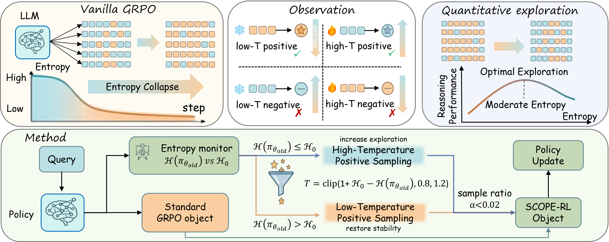

# SCOPE-RL

**Stable and Quantitative Control of Policy Entropy in RL Post-Training**

[Paper (arXiv:2510.08141)](https://arxiv.org/abs/2510.08141) · [Repository](https://github.com/597358816/SCOPE-RL)

SCOPE-RL addresses entropy collapse in GRPO by adding a small auxiliary update from **positive trajectories sampled at an adaptive temperature**. High-temperature positives raise exploration when entropy is low; low-temperature positives stabilize it when entropy is high. The paper reports gains in both Pass@1 and Pass@k and finds that reasoning performance is best at a moderate entropy level.



## Method

For a prompt $q$, response $o=(o_1,\ldots,o_{|o|})$, and logits $\ell$, temperature sampling uses
$\pi_\theta^T(o_t\mid q,o_{<t})=\frac{\exp(\ell(q,o_{<t},o_t)/T)}{\sum_v\exp(\ell(q,o_{<t},v)/T)}.$
The feedback signal is the mean token entropy over valid generated tokens:

$$
H(\pi_\theta)=
\mathbb{E}_{q,o\sim\pi_\theta}
\left[
-\frac{1}{|o|}\sum_{t=1}^{|o|}
\sum_v \pi_\theta(v\mid q,o_{<t})
\log\pi_\theta(v\mid q,o_{<t})
\right].
$$

Given the preceding update's entropy $H(\pi_{\theta_{\mathrm{old}}})$ and target $H_0$, the auxiliary sampling temperature is

$$
T=\rm{clip}\!\left(
1+H_0-H(\pi_{\theta_{\mathrm{old}}}),\,0.8,\,1.2
\right).
$$

The base GRPO objective is

$$
J_{\mathrm{GRPO}}(\theta)=
\mathbb{E}_{q,\{o_i\}_{i=1}^{G}\sim\pi_{\theta_{\mathrm{old}}}}
\left[
\frac{1}{G}\sum_{i=1}^{G}\frac{1}{|o_i|}
\sum_{t=1}^{|o_i|}
\min\!\left(
r_{i,t}(\theta)\hat A_i,\,
\rm{clip}(r_{i,t}(\theta),1-\epsilon_{\mathrm{low}},1+\epsilon_{\mathrm{high}})\hat A_i
\right)
\right],
$$

where

$$
r_{i,t}(\theta)=
\frac{\pi_\theta(o_{i,t}\mid q,o_{i,<t})}
{\pi_{\theta_{\mathrm{old}}}(o_{i,t}\mid q,o_{i,<t})},
\qquad
\hat A_i=
\frac{R(q,o_i)-\rm{mean}_{j=1}^{G}R(q,o_j)}
{\rm{std}_{j=1}^{G}R(q,o_j)}.
$$

SCOPE-RL adds a positive-trajectory regularizer to GRPO:

$$
J_{\mathrm{SCOPE}}(\theta)=J_{\mathrm{GRPO}}(\theta)+
\alpha\,
\mathbb{E}_{q,\{o'_i\}_{i=1}^{G'}\sim\pi_{\theta_{\mathrm{old}}}^{T}}
\left[
\frac{1}{G'}\sum_{i=1}^{G'}
\mathbf{1}[R(q,o'_i)=1]\frac{1}{|o'_i|}
\sum_{t=1}^{|o'_i|}
\min\!\left(
r'_{i,t}(\theta),\,
\rm{clip}(r'_{i,t}(\theta),1-\epsilon,1+\epsilon)
\right)
\right],
$$
$$
r'_{i,t}(\theta)=
\frac{\pi_\theta(o'_{i,t}\mid q,o'_{i,<t})}
{\pi_{\theta_{\mathrm{old}}}(o'_{i,t}\mid q,o'_{i,<t})}.
$$

The auxiliary trajectories are sampled with $\pi_{\theta_{\mathrm{old}}}^{T}$; the ratio in the regularizer uses the unscaled policy. In the paper's main setting, $H_0=0.5$, $\epsilon_{\mathrm{low}}=\epsilon_{\mathrm{high}}=\epsilon=0.2$, and the nominal auxiliary fraction is $\alpha=64/(512\times8)=1/64$.

## Results

**Average Pass@1 across seven math benchmarks** (paper [Table 1](https://arxiv.org/pdf/2510.08141#page=6); percentage points):

| Base model | Base | GRPO | SCOPE-RL | Gain vs. GRPO |
| --- | ---: | ---: | ---: | ---: |
| Qwen2.5-Math-7B | 32.56 | 51.60 | **54.84** | +3.23 |
| Qwen2.5-7B | 36.23 | 47.71 | **49.81** | +2.10 |
| Qwen3-4B | 57.03 | 67.77 | **69.73** | +1.96 |

**Qwen2.5-7B Pass@1024 on AIME** (paper [Table 3](https://arxiv.org/pdf/2510.08141#page=7); %):

| Method | AIME24 | AIME25 |
| --- | ---: | ---: |
| Base | 80.0 | 73.3 |
| GRPO | 73.3 | 63.3 |
| SCOPE-RL | **86.7** | **76.7** |

## Quick start

```bash
conda create -n scope-rl python=3.11
conda activate scope-rl
pip install torch==2.6.0 torchaudio==2.6.0 torchvision==0.21.0 vllm==0.8.3 transformers==4.51.2
pip install ray==2.48.0 tensordict==0.9.1 pydantic==2.11.7
pip install -e .
cd examples
bash qwen-math-7b-SCOPE.sh
```

Examples for Qwen2.5-Math-7B, Qwen2.5-7B, Qwen3-4B, and Llama-3.1-8B-Instruct are in [`examples/`](examples/), with matching GRPO baselines. Set model and data paths in each script before running. Evaluation follows [Qwen2.5-Math](https://github.com/QwenLM/Qwen2.5-Math).
